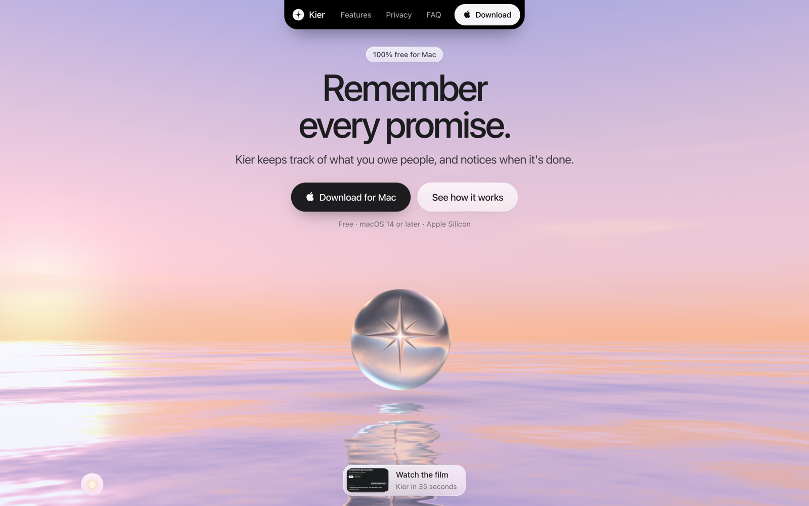

<p align="center">
  
</p>

<h1 align="center">Kier</h1>

<p align="center">
  <b>Remember every promise.</b><br>
  Kier keeps track of what you owe people, and notices when it's done.
</p>

<p align="center">
  <a href="https://getkier.com/download"></a>
  &nbsp;
  <a href="https://getkier.com"></a>
</p>

<p align="center"><sub>Free · macOS 14 or later · Apple Silicon</sub></p>

<p align="center">
  <a href="https://getkier.com"></a>
</p>

## What it does

You tell someone "I'll send it tomorrow" and then life happens. Kier reads the conversations you already have and keeps a short list of what you owe, to whom and by when. When you actually do the thing, it sees that too and ticks it off.

- **Reads where you talk.** WhatsApp, iMessage and SMS, calls, calendar, notifications, and the chat apps on your screen.
- **Finds what you owe.** Promises, requests and callbacks become cards with a person, a date and the message behind it.
- **Notices when it's done.** A sent file, a call back, a reply: Kier closes the card on its own.
- **Ask it anything.** "What did I tell Nika about the puzzle club?" It searches by meaning, in any language.

## Everything stays on your Mac

There is no Kier account and no Kier server. The app, your vault and the models that read it all run on your Mac. Nothing leaves it unless you hand something to Claude or ChatGPT yourself, or switch on an optional helper.

## Why the code is public

Kier reads your messages, so you should be able to read Kier. Every line that touches your data is here:

- [collectors](daemon/collectors/) read chats, calls, contacts, calendar, browser history, downloads, Git work and AI sessions
- [the app](app/main.swift) reads clipboard changes, app activity and visible chat messages through Accessibility
- [setup settings](daemon/lib/settings.mjs) switch any source off, everywhere
- [redaction](daemon/lib/redact.mjs) masks credentials and financial identifiers before anything is stored
- [privacy filters](daemon/lib/privacy.mjs) keep out adult content and let you forget anything
- [MCP](daemon/bin/mcp.mjs) lets local AI clients query the vault, read only by default, with every read logged

Kier never sends a chat reply or makes a payment. External model servers are optional and only see what Kier sends them when you pick one in [model settings](daemon/lib/model-settings.mjs). [Online helpers](daemon/lib/config.mjs), [cloud reviews](daemon/lib/doublecheck.mjs) and [Claude or Codex handoffs](daemon/lib/handoff.mjs) are opt-in, and a handoff shows you the exact brief before anything is sent. [Phone sync](app/PhoneSync.swift) is off by default; turned on, it writes to Calendar and Reminders, which your account provider may sync to your other devices.

## Read only, on purpose

Kier is made by one person. I'd rather fix things myself than sort through a thousand pull requests and issues, so this repo is a read only copy of each release, with pull requests and issues off. Fork it, read it, learn from it.

Found a security problem? Report it privately, as described in [SECURITY.md](SECURITY.md).

## Build it yourself

You need an Apple Silicon Mac with macOS 14 or later, Xcode command line tools with the Metal compiler, Node 23 or later, and Python 3.

```sh
npm --prefix daemon ci
npm --prefix daemon test
scripts/build-app.sh
```

The development app goes to `~/Applications/Kier.app` and runs the daemon from this checkout; set `KIER_APP` to build somewhere else. The build fetches and verifies Sparkle, and signs with your development certificate or an ad hoc signature. Grant the macOS permissions and install the local model from Setup.

`scripts/package-app.sh` makes a self-contained download; it also needs Bun and a Developer ID certificate. Release signing, notary profiles, the update feed and repository settings come from environment variables or a private `scripts/local.env`. Never commit that file.

Ask with Codex is switched off for now, because its CLI can't yet be limited to Kier's own tools; Ask with Claude works. MCP is read only unless a client you set up explicitly asks for `KIER_MCP_ROLE=read-write`, and switched off sources stay off for every query.

## License

The code is available under [FSL-1.1-ALv2](LICENSE), which turns into Apache 2.0 after two years.

## No warranty

Kier is free and provided as is, without warranty of any kind. Using it means you accept the [terms of use](https://getkier.com/terms/): Kier reads what you switch on, keeps it on your Mac, and the author is not liable for data loss, exposure or any other damage, to the fullest extent the law allows. Keeping your Mac secure (login, FileVault, updates, backups) is up to you. See [LICENSE](LICENSE) for the license terms.
